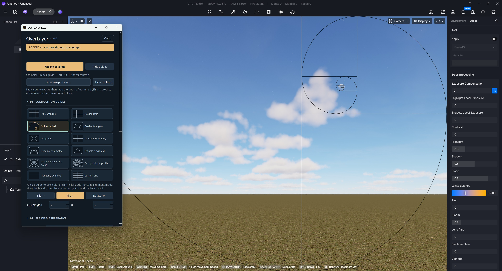
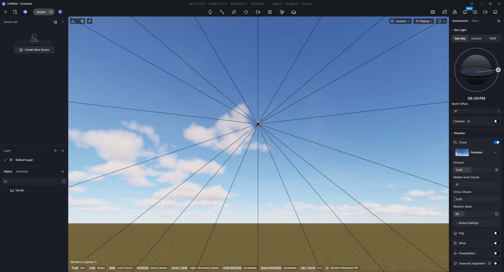
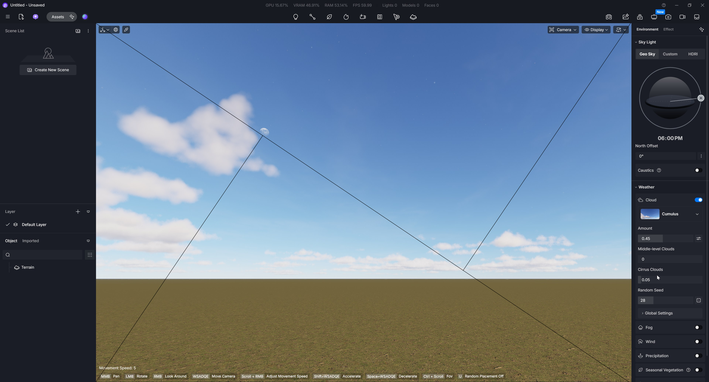

# OverLayer — Composition Overlay for D5 Render, Twinmotion & Creative Apps

**A sticky, transparent composition overlay for rendering, photography and design.**

[Download for Windows](https://github.com/hamzah1985/OverLayer/releases/latest) ·
[Source code](https://github.com/hamzah1985/OverLayer) ·
[Installation guide](#install--portable-windows-app)

Looking for a **D5 Render overlay**, **D5 OverLayer**, **Twinmotion OverLayer**, **Twinmotion overlay**, or
**Twinmotion composition guides**? OverLayer places rule-of-thirds grids,
golden-ratio guides, golden spirals, leading lines and perspective guides over
your viewport. It is free, open source, and works as an independent Windows app.

Position a frame over your viewport, choose your guides, then lock it. Mouse
clicks pass through to your app. When following an app window, closing the
controls keeps its overlay running.

Use it over your rendering viewport, 3D camera view, image editor or other
windowed creative software. D5 Render, Blender, SketchUp and other apps are
examples of possible hosts; OverLayer works independently of their plugin APIs.
There is nothing to install inside your creative application.

## Screenshots

**Golden spiral and composition controls in D5 Render**



| Leading lines in D5 Render | Golden triangles in D5 Render |
| --- | --- |
|  |  |

## Install — portable Windows app

1. Download `OverLayer-1.0.0-windows-x64.zip` from
   [GitHub Releases](https://github.com/hamzah1985/OverLayer/releases/latest).
2. Right-click the ZIP → **Extract All**. Keep the complete extracted folder.
3. Open **OverLayer.exe**. No Python installation or administrator access needed.

The release is unsigned. Windows may show an unknown-publisher prompt; verify
the source of your download and the published SHA-256 checksum before deciding
whether to run it. Do not run the executable directly inside the ZIP.

**Requirements:** Windows 10/11, x64. Your creative app should use its normal windowed or
borderless mode. Exclusive fullscreen is not supported.

## Your first composition

For **D5 Render** or **Twinmotion**, open your project in a normal windowed or
borderless window, select that app in **Align & follow**, and draw the overlay
over its viewport. Lock the guides to keep working through them. No D5 plugin
or Twinmotion plugin installation is needed; OverLayer runs separately.

1. Open your creative application and arrange its panels as you like.
2. In OverLayer's **Align & follow** section, select your app window and choose
   **Follow window**. The list refreshes each time you open it, shows each
   window's program name, and pre-selects known creative apps.
3. Choose **Draw viewport area…** (or press **Ctrl+Alt+A**) and drag a rectangle
   over the render viewport, like selecting a screenshot area. Release to fit;
   press Escape or right-click to cancel. Minimum area: 240 × 180 logical pixels.
   Each monitor has its own correctly scaled selector. Start and finish the
   rectangle on the monitor containing your viewport; dragging past its edge
   stays within that monitor.
4. Fine-tune using the eight corner/edge drag points, or drag inside to move the
   whole frame. Hold **Shift** while dragging for one-fifth-speed precision, or
   enter exact X / Y / Width / Height values in the controls.
5. Choose one or more guides. Flip or rotate them to suit your composition.
6. For leading lines or perspective, drag the teal vanishing-point handles.
7. Choose **Lock overlay**. You can now work normally in your app through the guides.
   **Enter** (including keypad Enter) also locks a visible overlay when OverLayer
   has focus. Use Ctrl+Alt+L or the controls to unlock it.
8. Close or hide the controls. The guides stay active. Use the tray icon or
   **Ctrl+Alt+P** to reopen controls.

## Sticky behavior

* A locked overlay ignores mouse input and has no close button.
* Closing controls hides them; it does not quit the application. If no host
  window is attached, closing controls also hides the guides. The explicit
  **Hide controls** button can keep a free overlay active.
* The notification-area icon remains available; Windows may put it under the
  tray's **Show hidden icons** arrow.
* Following a window keeps your frame's position and size proportional to that
  window's client area. It hides when the window is minimized or another app is
  active, and returns when you return to the attached window or OverLayer.
  Palettes, inspectors and dialogs that belong to the same app count as that
  app, so the guides stay put while you use them. **Match window** fits the
  frame to the followed window's content area.
* By default, following is selected per session: the last frame and guides
  persist, but you select your app window again after restarting OverLayer.
  A saved locked frame starts hidden until you draw an area or choose **Show
  guides**, so it does not reappear locked over the desktop. When an attached
  host window closes, its guides hide automatically.
  Tick **Follow this app automatically next time** to opt in to re-attaching,
  and restoring the frame, whenever that program has a window (including after
  it restarts). OverLayer remembers only the program's file name and the
  frame's proportions. Choosing **Detach window** turns auto-follow off for the
  session.
* Launching OverLayer again brings the existing controls back instead of
  creating another overlay. **Ctrl+Alt+H** always hides guides immediately.
* Changing your application's internal panel layout requires realigning the
  overlay manually. OverLayer does not inspect viewports or read project files.
* To quit, click **Quit…** near the top of the controls, press **Ctrl+Alt+Q**,
  or right-click the tray icon → **Quit OverLayer…**, then confirm.
  **Esc** offers to quit when the controls or unlocked overlay have focus.
  While drawing a new area, Esc cancels the selection instead. When you are
  working in another application, its normal Escape behavior is preserved.
  It can always be ended through Windows Task Manager as well.

## Guides and controls

| Guide | Purpose |
| --- | --- |
| Rule of thirds | Classic thirds intersections |
| Golden ratio | Grid at 0.382 / 0.618 |
| Golden spiral | The classic whirling-squares diagram: nested squares with a quarter-circle arc in each, built in a true golden rectangle and fitted to your frame. Every cut falls on the Golden ratio grid lines (0.618 / 0.382); the arcs are perfect circles on a 1.618:1 frame and slightly stretched on others |
| Golden triangles | Main diagonal and perpendicular corner lines |
| Diagonals | Both corner-to-corner diagonals |
| Center & symmetry | Horizontal and vertical center axes |
| Dynamic symmetry | Diagonals and their reciprocal lines |
| Triangle / pyramid | A triangular composition scaffold |
| Leading lines / one point | Rays meeting at your movable vanishing point |
| Two-point perspective | Two movable vanishing points sharing a horizon |
| Horizon / eye level | A movable eye-level line |
| Custom grid | 2–16 rows and columns |

Pick a guide from the tiles, each of which previews its own lines. One guide is
active at a time; hold **Shift** (or Ctrl) and click to combine several, and
click the only active guide to switch it off. Guides can be mirrored in either
direction and rotated in 90° steps. You can adjust
line color (quick swatches or any color), opacity and thickness; add a focal-point
marker and safe margins (1–25%, default 5%); and frame for viewport, 16:9, 3:2,
4:3, square, 4:5, 9:16, 2.39:1 or any custom ratio. **Dim outside crop** darkens
the area outside a crop frame. **Contrast halo** (off by default) draws a thin
light or dark outline under each line so guides stay readable on any image. Crop
frames are composition references; they do not change your app's camera or render
output. Leading lines guide your eye; they do not detect scene geometry automatically.

While the frame is unlocked, dragging shows its size and ratio; the arrow keys
nudge it by 1 px (Shift: 10 px) and Ctrl+arrows resize it. Shift-dragging a
vanishing point is also five times finer.

Reference images (PNG/JPEG/WebP/BMP) fit inside the selected frame with their
aspect ratio preserved. You can adjust opacity, scale (10–400%) and offset. They
are local files; presets remember their paths. Exported presets omit reference
paths and image contents.

## Shortcuts

| Shortcut | Action |
| --- | --- |
| Enter | Lock a visible overlay while OverLayer has focus |
| Ctrl+Alt+A | Draw a viewport rectangle |
| Ctrl+Alt+L | Lock / unlock for alignment |
| Ctrl+Alt+O | Show / hide guides |
| Ctrl+Alt+H | Hide guides immediately |
| Ctrl+Alt+P | Show / hide controls |
| Ctrl+Alt+Q | Offer to quit from anywhere |
| Ctrl+Alt+PgDn / PgUp | Next / previous preset (its name flashes on the frame) |
| Esc | Offer to quit from controls/alignment; cancel area selection |

The global shortcuts can be changed in the **Shortcuts** section of the controls.
Shortcuts are global while OverLayer runs. If another app has reserved one,
OverLayer displays a message; use the tray controls instead. On keyboard layouts
with an AltGr key (for example Polish or German), AltGr is Ctrl+Alt, so a
Ctrl+Alt+letter shortcut would swallow that letter; OverLayer warns you and you
can rebind it.

## Save and share a view

Settings save automatically as you work; the line at the bottom of the controls
confirms it. **Reset appearance** restores the default guides and appearance (black
lines, 1.25 px) while keeping your viewport placement, window attachment, lock
state and named presets. An **Undo** button appears for a few seconds afterwards.

Use **Save preset…** to name a preset for a camera/view. **Load** restores its guides,
frame, points and appearance. Use **Export preset…** and **Import preset…** to
share a `.json` preset. After importing, align the frame for your own monitor.
Presets are managed manually; camera changes do not select them automatically.

Settings and presets are stored in `%LOCALAPPDATA%\OverLayer\settings.json`.
The guide frame and control panel automatically remember their last screen
position and size, including the monitor used, and restore them on relaunch.
If a saved monitor is disconnected, windows are brought back onto an available
screen. Instructions stay in the control panel; the overlay shows text only
briefly, as a size readout while you adjust it or a preset name when you switch.
There are no accounts, telemetry, background network calls or automatic updates.
To uninstall, quit and delete the extracted app folder. Delete the settings
folder too if you want to remove your presets.

## Run from source

Install Python 3.11 or newer (64-bit), then open PowerShell in this folder:

```powershell
py -3.11 -m venv .venv
.\.venv\Scripts\python.exe -m pip install -r requirements.txt
.\.venv\Scripts\python.exe -m overlayer
```

No PowerShell execution-policy changes are needed. Python 3.11 x64 is the
tested build environment. To run tests and produce a portable ZIP, see
[CONTRIBUTING.md](CONTRIBUTING.md).

## Current status

Version 1.0.0 is the first Windows release by Bogdan Demchenko. Automated checks cover guide math,
settings validation and native overlay behavior. Window following is based on
client bounds; mixed-DPI multi-monitor arrangements and different application layouts
need further real-world testing. Screen captures can include the overlay; hide
it before taking a clean screenshot. Your application's rendered image is not modified.

## License

Application source: [MIT](LICENSE). Bundled Qt/PySide libraries have their own
terms; see [THIRD_PARTY_NOTICES.md](THIRD_PARTY_NOTICES.md). Contributions welcome.
